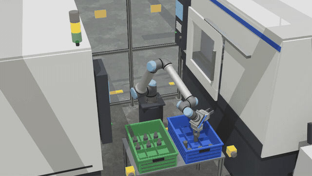
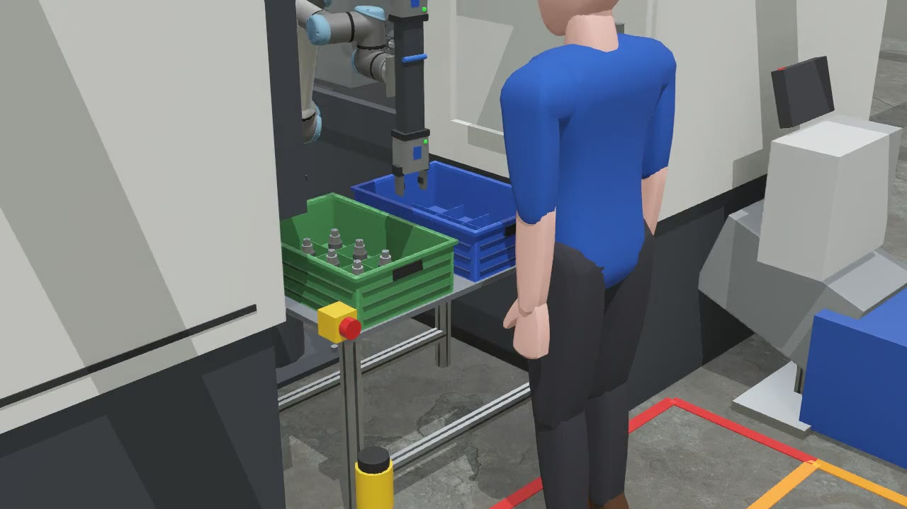

[English](README.md) · **Français**

# Cellule de tournage robotisée — Webots R2025a

Deux tours CNC face à face, servis par un **Universal Robots UR10e**. Le robot porte une **double pince de type SCHUNK**
(deux pinces parallèles dos à dos) montée derrière un **capteur d'effort 6 axes**. Les bruts arrivent dans une caisse,
et les pièces tournées repartent dans une seconde caisse. Quand la caisse de bruts est vide, un opérateur vient échanger
les caisses. Le côté avant, ouvert et collaboratif, est surveillé par deux scrutateurs laser (surveillance de vitesse
et de distance).

**▶ [Animation 3D interactive dans le navigateur](https://nicolasbrochen.github.io/turning-cell-webots/)** (GitHub Pages, sans installer Webots) · [vidéo de la séquence complète, accélérée ×4 (MP4)](docs/turning_cell.mp4)

[](docs/turning_cell.mp4)

| Service d'un tour avec la double pince | Échange des caisses (scrutateurs laser) |
|---|---|
| [](docs/lathe_service.mp4) | [](docs/crate_exchange.mp4) |

## Visualiser sans Webots

- **Animation 3D interactive** : [nicolasbrochen.github.io/turning-cell-webots](https://nicolasbrochen.github.io/turning-cell-webots/).
  C'est un export HTML5 de Webots de 3 min 48 s de production (les deux tours, les échanges de pinces, l'échange des
  caisses) : on peut tourner autour, zoomer et avancer dans le temps. Fichiers dans [`site/`](site/), publiés depuis la
  branche `gh-pages` (`git subtree push --prefix site origin gh-pages`).
- **Vidéos** : [`docs/`](docs/).
- **Reconstruire** : `tools/build_site.sh` (animation) et `tools/build_media.sh` (vidéos, GIF, images). Sous WSL, ils
  utilisent automatiquement **Webots Windows** s'il est installé avec un Python Windows (rendu direct sur le GPU) ;
  `WEBOTS_MODE=linux` force le Webots Linux ([`tools/webots_env.sh`](tools/webots_env.sh)). Laisser la fenêtre Webots
  visible pendant l'enregistrement des vidéos.

## Lancer dans Webots

```
webots worlds/tournage.wbt
```

## Cycle

1. **Prise d'un brut** (pince 1) dans la caisse bleue : la pince descend à la verticale, les doigts se ferment et les
   capteurs de bout de doigt confirment la prise (force de serrage lue sur les moteurs de doigts, ~140 N par doigt).
2. **Service d'un tour en une seule visite**, grâce à la double pince :
   - la pince 2 entre par la porte ouverte, saisit la pièce tournée, l'automate ouvre le mandrin, le robot extrait la pièce ;
   - un demi-tour du poignet 3 présente la pince 1 devant le mandrin : le brut est poussé le long de l'axe de broche en
     **mode effort**, et le capteur d'effort du poignet arrête le mouvement quand la pièce touche la butée du mandrin
     (seuil 40 N) ;
   - l'automate serre le mandrin, la pince s'ouvre, le robot sort de la machine et signale « dégagé ».
3. **Cycle de tournage** (automate) : la porte se ferme et se verrouille, la broche démarre, la tourelle approche et
   fait une passe avec arrosage. La surépaisseur disparaît au fur et à mesure de l'avance de l'outil. Puis la tourelle
   se retire, la broche s'arrête et la porte s'ouvre.
4. **Dépose de la pièce finie** (pince 2) dans la caisse verte : la pièce est posée en mode effort (contact avec le fond
   détecté à 20 N), puis relâchée.
5. Le robot alterne entre le tour A et le tour B, en servant toujours d'abord celui qui a terminé.
6. **Échange des caisses** : quand la caisse de bruts est vide, l'opérateur vient à la table. Les scrutateurs ralentissent
   d'abord le robot (25 % en champ d'avertissement), puis l'arrêtent (champ de protection). L'opérateur échange les
   caisses et repart, et le robot reprend automatiquement à pleine vitesse.

## Modèles

| Élément | Source |
|---|---|
| Robot | `UR10e` (bibliothèque officielle Webots, Universal Robots) sur socle acier |
| Double pince | Construite pour ce projet : capteur d'effort 6 axes, adaptateur alu, 2 pinces parallèles (corps type SCHUNK EGK), doigts motorisés sur glissières, mors en V avec capteurs de contact, LED d'état. SCHUNK ne fournit pas de modèle Webots |
| Tours CNC | Construits pour ce projet (aucun tour dans la bibliothèque Webots) : banc fonte, carénage, porte coulissante automatique vitrée, poupée, mandrin 3 mors (mors mobiles), banc incliné à 45°, tourelle 8 postes avec plaquette, arrosage, pupitre CNC, colonne lumineuse, convoyeur et bac à copeaux |
| Caisses | Construites pour ce projet : bacs plastique 400×600×180 (type KLT) avec nervures, poignées et 12 alvéoles |
| Pièces | Brut Ø50 × 90 mm → arbre étagé Ø40 / Ø30 (la zone serrée reste brute) |
| Opérateur | `Pedestrian` (bibliothèque officielle), marche animée par l'automate avec les tables de pas officielles |
| Atelier | Bardage, poteaux, fermes et luminaires, rack à barres, établi, armoire à outils, deux autres tours |

La géométrie statique est fusionnée par matériau en `IndexedFaceSet` (même méthode que la cellule de palettisation).

## Capteurs

| Capteur | Réalisation | Usage |
|---|---|---|
| **Capteurs d'effort de bout de doigt** (×4) | `TouchSensor` Webots (contact) sur chaque doigt + retour d'effort des moteurs de doigts (`LinearMotor.getForceFeedback`) | Contrôle de prise : les deux doigts en contact à ≥ 50 N, sinon « grip failed » et réouverture |
| **Capteur d'effort 6 axes au poignet** | Émulé par le contrôleur robot (raideur de contact 40 kN/m au-delà du point de contact) | Mouvements gardés en effort : mise en butée du brut dans le mandrin (40 N), dépose dans la caisse (20 N) |
| **Codeurs articulaires** | `PositionSensor` sur les 6 axes et les 4 doigts | Cinématique, suivi de la pièce transportée, course des doigts |
| **Scrutateurs laser** (×2) | Éventails de 31 faisceaux de distance à 0,18 m | Champ d'avertissement → 25 % de vitesse, champ de protection → arrêt de protection, reprise automatique |
| Interverrouillages porte / mandrin | États de l'automate | Pas de broche porte ouverte, pas d'entrée robot broche en rotation |

## Sécurités

- **Côté avant collaboratif** (ISO/TS 15066, surveillance de vitesse et de distance) : 2 scrutateurs laser, champ
  d'avertissement (orange, de 2,0 à 2,8 m) et champ de protection (rouge, de 1,4 à 2,0 m) marqués au sol.
- **Carter fixe** à l'arrière entre les deux machines (profilés alu + polycarbonate, même `GuardBay.proto` que la
  cellule de palettisation).
- **Portes des tours** interverrouillées : fermées et verrouillées pendant le tournage, ouvertes seulement broche arrêtée.
- **Arrêts d'urgence** sur la table et sur chaque pupitre CNC : défaut mémorisé, réarmement refusé tant que le bouton
  est enfoncé.
- **Colonnes lumineuses** sur chaque tour (vert = tournage, orange = attente robot, rouge = défaut).

## Clavier (cliquer d'abord dans la vue 3D)

| Touche | Action |
|---|---|
| `E` | Arrêt d'urgence (enfoncer / déverrouiller) |
| `R` | Réarmement |
| `P` | Appeler l'opérateur pour échanger les caisses |
| `S` | Arrêt fin de cycle / redémarrage |

Les mêmes lettres peuvent être écrites dans le champ `customData` du robot « automate cellule ». La vue 3D affiche les
deux derniers événements de l'automate (en jaune, en anglais).

## Logiciel

```
controllers/
  cell_plc/cell_plc.py          automate de cellule (superviseur) : tours, caisses, ordonnancement, échanges, sécurités, opérateur
  ur_tending/ur_tending.py      UR10e : mouvements articulaires / linéaires / gardés en effort, pinces, transport des pièces
  ur_tending/ur10e_kin.py       cinématique exacte du UR10e (relevée dans UR10e.proto) + IK numérique 6 ddl, sans dépendance
tools/gen_world.py              génère worlds/tournage.wbt
tools/build_site.sh             animation 3D HTML5 -> site/ (GitHub Pages)
tools/build_media.sh            vidéos, GIF et images -> docs/
tools/webots_env.sh             choix du Webots (Windows sous WSL, sinon Linux)
tools/wbtgen.py                 briques de génération communes (fusion de géométrie, profilés alu)
protos/GuardBay.proto           travée de carter (profilés alu + polycarbonate)
```

L'automate envoie au robot des ordres sous forme de listes d'étapes (JSON, Emitter/Receiver). Chaque étape est un
mouvement articulaire, un mouvement linéaire, un mouvement gardé en effort, une prise / ouverture, un événement, ou un
échange avec la machine (« chuck_open », « chuck_clamp », acquittés par l'automate).

Cinématique :
- **IK :** numérique (moindres carrés amortis, erreur d'orientation exacte).
- **Orientation du poignet :** la pince est orientée pour que le poignet reste toujours du côté du robot (bride vers
  le bas aux tours, dos à la base aux caisses).
- **Configurations de départ :** une par poste (base tournée vers le tour, coude en haut, poignet 2 à ±90°), loin de
  la singularité de poignet UR. Passer d'une pince à l'autre ne demande qu'un demi-tour du poignet 3.

## Simplifications

- Les pièces sont transportées de façon cinématique une fois la prise confirmée. Le robot, lui, bouge avec ses vrais
  moteurs, et les doigts serrent réellement la pièce (contact physique).
- Le capteur d'effort du poignet est émulé (Webots n'a pas de capteur 6 axes mesurant un torseur transmis par une liaison).
- Le tournage est représenté, pas calculé : la surépaisseur raccourcit au fil de l'avance de l'outil, et la vitesse de
  broche est ralentie pour rester visible.
- À l'échange des caisses, les pièces tournées sont réutilisées comme nouveaux bruts (réserve fixe de 16 pièces).
