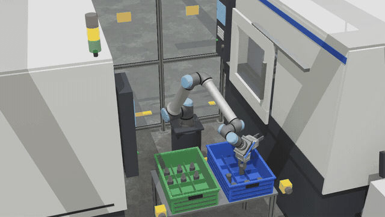
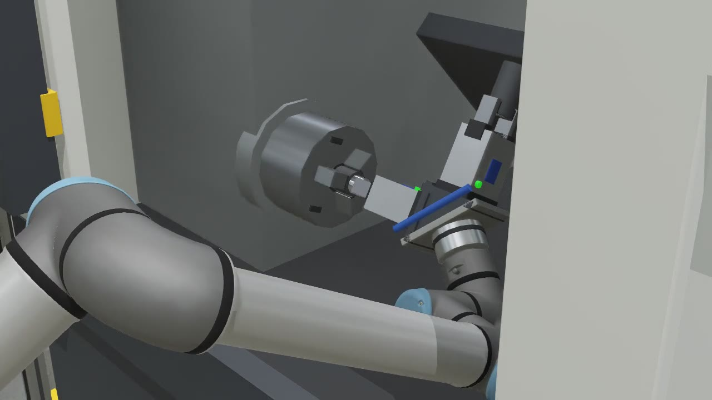
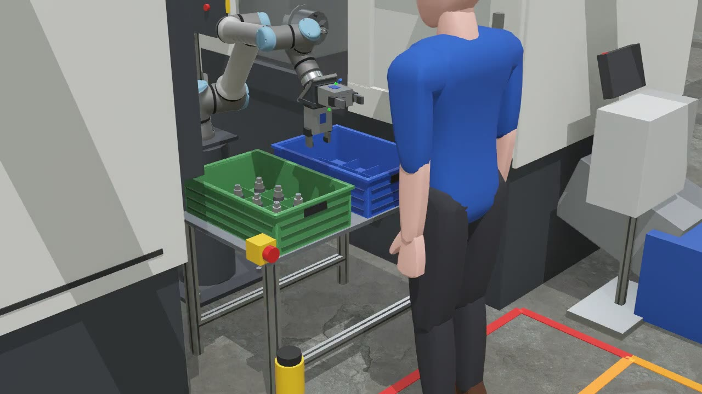

**English** · [Français](README.fr.md)

# Robotic turning cell — Webots R2025a

Two CNC lathes face each other 1.6 m apart, tended by a **Universal Robots UR10e**. The robot carries a **dual
SCHUNK-type gripper** (two parallel grippers on a 90° bent bracket, each at 45° from the flange axis) behind a
**6-axis force/torque sensor**. Blanks come from a crate, and the
turned parts go to a second crate. When the blank crate is empty, an operator walks in to swap the crates. The open,
collaborative front side is guarded by two laser scanners (speed and separation monitoring).

**▶ [Interactive 3D animation in the browser](https://nicolasbrochen.github.io/turning-cell-webots/)** (GitHub Pages, no Webots needed) · [video of the full sequence, 4× speed (MP4)](docs/turning_cell.mp4)

[](docs/turning_cell.mp4)

| Lathe service with the dual gripper | Crate exchange (laser scanners) |
|---|---|
| [](docs/lathe_service.mp4) | [](docs/crate_exchange.mp4) |

## Viewing without Webots

- **Interactive 3D animation**: [nicolasbrochen.github.io/turning-cell-webots](https://nicolasbrochen.github.io/turning-cell-webots/).
  It is a Webots HTML5 export of 4 min 06 s of production (both lathes, dual-gripper swaps, crate exchange): orbit,
  zoom and scrub the timeline. Files in [`site/`](site/), published from the `gh-pages` branch
  (`git subtree push --prefix site origin gh-pages`).
- **Videos**: [`docs/`](docs/).
- **Rebuilding**: `tools/build_site.sh` (animation) and `tools/build_media.sh` (videos, GIF, stills). Under WSL they use
  **Webots for Windows** automatically when it is installed with a Windows Python (rendering straight on the GPU);
  `WEBOTS_MODE=linux` forces the Linux Webots ([`tools/webots_env.sh`](tools/webots_env.sh)). Keep the Webots window
  visible while the videos record.

## Running in Webots

```
webots worlds/tournage.wbt
```

## Cycle

1. **Pick a blank** (gripper 1) from the blue crate: the gripper comes down vertically, the fingers close and the
   fingertip sensors confirm the grip (clamping force read from the finger drives, ~140 N per finger).
2. **Lathe service in a single visit**, using the dual gripper:
   - gripper 2 enters through the open door, grips the turned part, the PLC opens the chuck, the robot pulls the part out;
   - half a turn of wrist 3 brings gripper 1 in front of the chuck (the bent bracket makes the two grippers swap
     places): the blank is pushed in along the spindle axis in
     **force mode**: the wrist F/T sensor stops the move once the part touches the chuck stop (40 N threshold);
   - the PLC clamps the chuck, the gripper opens, the robot leaves the machine, goes back above the crate table and
     reports "clear" (the door only closes once the arm is out of its way).
3. **Turning cycle** (PLC): the door closes and locks, the spindle starts, the turret approaches and makes a pass with
   coolant. The stock is removed progressively as the tool moves along the part. Then the turret retracts, the spindle
   stops and the door opens.
4. **Put away the finished part** (gripper 2) in the green crate: the part is set down in force mode (contact with the
   crate bottom detected at 20 N), then released.
5. The robot alternates between lathe A and lathe B, always serving first the one that has finished.
6. **Crate exchange**: when the blank crate is empty, the operator walks to the table. The scanners first slow the robot
   down (25 % in the warning field), then stop it (protective field). The operator swaps the crates and leaves, and the
   robot resumes automatically at full speed.

## Models

| Item | Source |
|---|---|
| Robot | `UR10e` (official Webots library, Universal Robots) on a steel pedestal |
| Dual gripper | Built for this project: 6-axis F/T sensor, aluminium adapter plate, 90° bent bracket with side gussets, 2 parallel grippers (SCHUNK EGK-style body) at ±45° from the flange axis, motorized fingers on slide joints, pads with contact sensors, status LEDs. SCHUNK provides no Webots model. Geometry in [`dual_gripper.py`](controllers/ur_tending/dual_gripper.py) |
| CNC lathes | Built for this project (no lathe exists in the Webots library): cast bed, enclosure, automatic sliding door with window, headstock, 3-jaw chuck (moving jaws), 45° slant bed, 8-station turret with insert, coolant, CNC control panel, stack light, chip conveyor and bin |
| Crates | Built for this project: 400×600×180 plastic crates (KLT type) with ribs, handles and 12-cell dividers |
| Parts | Ø50 × 90 mm blank → stepped shaft Ø40 / Ø30 (the clamped zone stays raw) |
| Operator | `Pedestrian` (official library), walking animated by the PLC with the official gait tables |
| Workshop | Cladding, columns, roof trusses and lights, bar stock rack, workbench, tool cabinet, two more lathes |

Static geometry is merged per material into `IndexedFaceSet` nodes (same method as the palletizing cell).

## Sensors

| Sensor | Implementation | Use |
|---|---|---|
| **Fingertip force sensors** (×4) | Webots `TouchSensor` (contact) on each finger + finger drive force feedback (`LinearMotor.getForceFeedback`) | Grip check: both fingers in contact with ≥ 50 N, otherwise "grip failed" and the fingers re-open |
| **Wrist 6-axis F/T sensor** | Emulated by the robot controller (contact stiffness 40 kN/m beyond the contact point) | Force-guarded moves: seating the blank against the chuck stop (40 N), setting the part down in the crate (20 N) |
| **Joint encoders** | `PositionSensor` on the 6 axes and the 4 fingers | Kinematics, carried-part tracking, finger stroke |
| **Laser scanners** (×2) | Fans of 31 distance beams at 0.18 m height | Warning field → 25 % speed, protective field → protective stop, automatic restart |
| Door / chuck interlocks | PLC states | No spindle start with the door open, no robot entry while the spindle turns |

## Safety

- **Collaborative front side** (ISO/TS 15066, speed and separation monitoring): 2 laser scanners, warning field (orange,
  2.0 to 2.8 m) and protective field (red, 1.4 to 2.0 m) marked on the floor.
- **Fixed guarding** at the back between the two machines (aluminium profiles + polycarbonate, same `GuardBay.proto` as
  the palletizing cell).
- **Lathe doors** with interlock: closed and locked during turning, open only when the spindle has stopped.
- **Emergency stops** on the table and on each CNC panel: latched fault, reset refused while the button is pressed.
- **Stack lights** on each lathe (green = turning, orange = waiting for the robot, red = fault).

## Collisions

Every machine, the table, the crates and their dividers, the robot (UR10e links, F/T sensor, bent bracket, grippers,
fingers) have **collision volumes** (`boundingObject`), so a contact is a real contact in the physics engine:

- **In Webots**: *View > Optional Rendering > Show All Bounding Objects* draws the collision volumes, and *Show Contact
  Points* draws every contact live. The lathe doors, chucks, jaws and turrets are separate solids, so their collision
  volumes move with them.
- **Collision monitor** (cell PLC): every time step it reads the robot's contact points. The only expected contact is a
  finger pad on the part being gripped. Any other contact is a collision: a red sphere is put at the contact point,
  a red line `COLLISION #n: <robot part> <-> <obstacle>` appears in the 3D view and the event is printed in the console.
  The markers exist from the start, so they also show in the HTML5 animation.
- **`tools/sim_check.sh`**: runs the cell in Webots without rendering (240 s of production by default) and lists the
  collisions, grips and F/T contacts; exit code 1 if a collision was detected.
- **`tools/check_collisions.py`** (offline, needs numpy: `uv run --no-project --with numpy tools/check_collisions.py`):
  replays the robot cycle with the same IK and the same job steps as the controllers, measures the clearance between
  the robot (with the carried parts) and every collision volume (exported by `tools/gen_world.py` to
  `worlds/obstacles.json`), including self-collisions of the tool against the arm. This is how the gripper orientation
  in the lathes and the joint seeds were chosen. Current result: no collision, smallest clearances are the fingers near
  the crate walls (> 7 mm).

The UR10e base is turned so that its zero pose (arm stretched out) points to the free back side, and the start-up
folds the arm before turning the base: nothing is swept on the way to the home position.

## Keyboard (click in the 3D view first)

| Key | Action |
|---|---|
| `E` | Emergency stop (press / release) |
| `R` | Reset |
| `P` | Call the operator to swap the crates |
| `S` | End-of-cycle stop / restart |

The same letters can be written into the `customData` field of the "automate cellule" robot. The 3D view shows the
PLC's last two events (yellow, in English).

## Software

```
controllers/
  cell_plc/cell_plc.py          cell PLC (supervisor): lathes, crates, scheduling, handshakes, safety, operator
  ur_tending/ur_tending.py      UR10e: joint / linear / force-guarded moves, grippers, part transport
  ur_tending/ur10e_kin.py       exact UR10e kinematics (from UR10e.proto) + 6-DOF numerical IK, no dependency
  ur_tending/dual_gripper.py    geometry of the bent dual gripper (TCPs), robot base orientation
tools/gen_world.py              generates worlds/tournage.wbt (+ worlds/obstacles.json, collision volumes)
tools/check_collisions.py       offline collision check of the whole robot cycle
tools/sim_check.sh              Webots run without rendering + collision report
tools/build_site.sh             HTML5 3D animation -> site/ (GitHub Pages)
tools/build_media.sh            videos, GIF and stills -> docs/
tools/webots_env.sh             Webots selection (Windows under WSL, else Linux)
tools/wbtgen.py                 shared generator blocks (geometry merging, aluminium profiles)
protos/GuardBay.proto           guarding bay (aluminium profiles + polycarbonate)
```

The PLC sends the robot jobs as lists of steps (JSON, Emitter/Receiver). Each step is a joint move, a linear move, a
force-guarded move, grip / open, an event, or a handshake with the machine ("chuck_open", "chuck_clamp", acknowledged by
the PLC).

Kinematics:
- **Inverse kinematics:** numerical (damped least squares, exact orientation error).
- **Wrist orientation:** with the bent bracket the flange normal is at 45° from the approach direction. In the lathes
  the idle gripper points up and towards the back of the machine (the flange and the wrist stay low and on the robot
  side); at the crates it points away from the base.
- **Starting configurations:** one per station (base turned towards the lathe, elbow up), found by the offline
  collision checker. Switching from one gripper to the other only takes half a turn of wrist 3.

## Simplifications

- Parts are carried kinematically once the grip is confirmed. The robot itself moves with its real motors, and the
  fingers really clamp the part (physical contact).
- The wrist F/T sensor is emulated (Webots has no 6-axis force sensor that measures a wrench transmitted through a joint).
- Turning is shown, not computed: the stock sleeve shortens as the tool advances, and the spindle speed is slowed down
  to stay visible.
- At the crate exchange, the turned parts are reused as new blanks (fixed pool of 16 parts).
